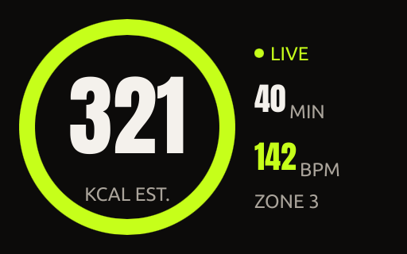

<picture>
  <source media="(prefers-color-scheme: dark)" srcset="packaging/brand/sweatxr-mark.svg">
  
</picture>

# SweatXR: free VR fitness and calorie tracker for every SteamVR game

**A free, open-source calorie counter and heart rate watch for SteamVR.** Glance at your wrist
in any VR game to see calories burned, active minutes, heart rate and your daily goal ring.
It keeps history per day and per game, and your data never leaves your computer.

[](https://github.com/EncidXVII/SweatXR/actions/workflows/ci.yml)
[](https://github.com/EncidXVII/SweatXR/releases/latest)
[](LICENSE)


<p>
  
</p>

| VR panel | Desktop history |
|---|---|
|  |  |

**[Download for Windows](https://github.com/EncidXVII/SweatXR/releases/latest/download/sweatxr-windows-x64.zip)**
· **[Linux x64 AppImage](https://github.com/EncidXVII/SweatXR/releases/latest/download/sweatxr-linux-x64.AppImage)**
· **[Linux arm64 / Steam Frame](https://github.com/EncidXVII/SweatXR/releases/latest/download/sweatxr-linux-arm64.AppImage)**
· [All downloads](https://github.com/EncidXVII/SweatXR/releases/latest)

> **Status: first release, looking for testers.** Calorie numbers are estimates and this is not
> a medical device. Comparisons against your fitness watch are what it needs most, then reports
> from Linux and Steam Frame: see [Status and help wanted](#status-and-help-wanted).

## At a glance

| | |
|---|---|
| **What it is** | A SteamVR overlay that counts calories burned, active minutes and heart rate zones in any VR game, on a wrist watch you glance at while you play |
| **Use it for** | Tracking VR workouts in rhythm, boxing, dance and sports games, daily calorie goals and streaks, calories per game, exporting workouts as TCX or CSV |
| **Platforms** | Windows, Linux (x64 AppImage), Steam Frame (arm64) |
| **Headsets** | Anything on SteamVR: Valve Index, Steam Frame, HTC Vive, Pimax, Bigscreen Beyond, Windows Mixed Reality, Meta Quest through Steam Link, Virtual Desktop or a Link cable |
| **Heart rate** | Optional: any Bluetooth LE chest strap or armband with the standard heart rate service; without one it estimates from head and hand movement |
| **Privacy** | Everything stays in one file on your computer. No account, no cloud, no network access |
| **Price** | Free. No subscription |
| **Status** | First release (1.0): calorie numbers are estimates that need comparisons against fitness watches; Linux and Steam Frame builds need testers |
| **License** | Open source, `GPL-3.0-only`, © 2026 EncidXVII |

## Features

- **Works in every SteamVR game.** No mods, no per-game support, no plugins. Rhythm, boxing,
  dance, sports and flat-to-VR ports all count.
- **Wrist watch overlay.** Calories, active minutes, heart rate, heart rate zone and a daily
  goal ring. It dims when you look away, brightens on a glance and hides near your face.
- **Heart rate monitor support.** Pairs any Bluetooth LE chest strap or armband that uses the
  standard heart rate service, for better calorie estimates.
- **Accurate without a strap too.** It estimates effort from head and hand movement, then
  calibrates that estimate to your own body after 20 minutes with a strap.
- **Calories per game.** See which VR game burns the most, with daily goals, streaks and a
  week and 30-day history.
- **Export your workouts.** TCX for a session or a day, which most fitness apps can import, and
  CSV with every second.
- **Private by design.** No account, no cloud, no telemetry, no network access.
- **Fast and light.** Native Rust, about 0.1 ms per redraw, starts with SteamVR.

## Supported headsets

Anything that runs SteamVR: Valve Index, Steam Frame (natively on the headset, arm64), HTC Vive,
Pimax, Bigscreen Beyond, Windows Mixed Reality, and Meta Quest through Steam Link, Virtual
Desktop or a Link cable. Standalone Quest apps do not run SteamVR, so they are not tracked.

## Install in 3 steps

1. Download the archive for your system from the
   [latest release](https://github.com/EncidXVII/SweatXR/releases/latest) and check it
   against its `.sha256` file.
2. Windows: unpack the zip anywhere and keep the folder. Linux or Steam Frame (Developer Mode):
   either make the `.AppImage` executable and keep it where it is, or unpack the `.tar.gz` and
   run `./install.sh`.
3. Run `sweatxr` once. It registers itself with SteamVR; if SteamVR is running, the watch appears
   on your wrist right away, and from then on it starts with SteamVR. Turn that off in
   Settings > Device > Start with SteamVR.

**Uninstall:** quit SweatXR (Windows: tray icon > Quit; Linux: close its window) and SteamVR, then run
`Uninstall SweatXR.cmd` in its folder (Windows) or `./uninstall.sh` (Linux; or `sweatxr --uninstall`). It takes
SweatXR off SteamVR's list and deletes its settings and workout history; exports in `Documents/SweatXR` stay.
Then delete the folder.

## Use

- **Watch:** on your left wrist (switch hands in Settings). Today's calories sit inside the goal
  ring; active minutes, heart rate and zone are beside it. It dims when you are not looking, goes
  full brightness after a short glance and hides when the controller is near your face. "LIVE"
  means a session is being counted. When you reach your goal it turns lime and buzzes.
- **Panel:** point at the watch with the other controller (a laser shows where you aim) and
  pull the trigger. Today, Week and Settings. Rebind the button in SteamVR's controller bindings
  under SweatXR.
- **Desktop:** `sweatxr` opens Today, History (step back through past weeks and months), Sessions
  (each session with its own export) and Settings. On Windows it sits in the tray.
- **Heart rate:** Settings > Device > Scan, then pick your strap. Choosing it on the desktop
  saves the choice; the VR overlay connects.
- **Export:** TCX and CSV files go to `Documents/SweatXR`.
- **Your data:** Settings > Data shows where it is stored and deletes all history (two clicks).
- **Theme:** Settings > Look (or Setup in VR) picks the accent colour, one of eight shared with WristXR.

## Privacy

No account, no telemetry, no network access. Everything is in one SQLite file:
`%APPDATA%\SweatXR\data\sweatxr.db` on Windows, `~/.local/share/sweatxr/sweatxr.db` on Linux.
Logs (`overlay.log`, `desktop.log`) sit next to it and contain game names, nothing else personal.

## Accuracy

All numbers are estimates.

- **With a heart rate strap:** the Keytel et al. (2005) equation from heart rate, weight, age
  and sex. Aim: within about 20% of a dedicated fitness watch.
- **Without one:** head and hand speed mapped to METs. Aim: within about 35%. After 20 minutes
  of play with a strap, the app fits motion to your own heart-rate data and uses that fit when
  the strap is off.
- **What counts:** only time in play. Standing in menus does not count, and the idle minutes
  before a session ends are dropped.

## Status and help wanted

SweatXR is a first release (1.0). Where each part stands, and what moves it forward:

| Area | Where it stands | What helps |
|---|---|---|
| **Calorie accuracy** | The numbers are estimates. The aim is within about 20% of a fitness watch with a heart rate strap and about 35% without one; it takes sessions from more people and more kinds of games to confirm and tune that | An [accuracy report](https://github.com/EncidXVII/SweatXR/issues/new/choose): 10 minutes of play with a strap and a fitness watch running, then both numbers. Rhythm, boxing and slow games all help |
| **Linux and Steam Frame (arm64)** | Built and packaged for both. Reports from real machines are still missing | Install it, play a session and say what worked: the watch, the panel, Bluetooth heart rate, start with SteamVR |
| **Controllers** | The watch sits on the back of the wrist, and that spot has to suit every controller shape | Tell us how it sits on yours: Index, Touch, Steam Frame, Vive |
| **Heart rate straps** | Any strap, armband or watch with the standard Bluetooth LE heart rate service should pair | Name the strap you paired, working or not |
| **Not a medical device** | A fitness estimate for play, not a measurement | Nothing: it stays that way |

How to send any of these: [CONTRIBUTING.md](CONTRIBUTING.md).

## FAQ

### How many calories does VR gaming burn?
It depends on the game and on you. Rhythm and boxing games often reach the effort of brisk
walking or jogging, while seated games burn little more than resting. SweatXR measures your
own sessions, so you see the real number for each game you play.

### Does it work with Meta Quest?
Yes, when the Quest plays SteamVR games from a PC through Steam Link, Virtual Desktop or a Link
cable. Games running standalone on the Quest are outside SteamVR and are not tracked.

### Does it work on Steam Frame?
Yes. The Linux arm64 build runs natively on the headset (Developer Mode), and the Windows or
Linux build works when you stream from a PC.

### Do I need a heart rate monitor?
No. Without one, calories are estimated from movement. A Bluetooth LE heart rate strap makes
estimates better, and 20 minutes with one calibrates the movement estimate to you.

### Which heart rate straps work?
Any chest strap, armband or watch that broadcasts the standard Bluetooth LE heart rate service.
Most dedicated fitness straps do.

### Does it change or slow down my games?
No. It reads tracking from SteamVR and draws a small overlay; it never touches game files.
A redraw takes about 0.1 ms.

### Can I import my VR workouts into other fitness apps?
Yes. Export a session or a whole day as TCX, which most fitness apps and training logs import,
or everything as CSV.

### Is it free?
Yes, free and open source under GPL-3.0, with no account, ads or subscription.

## Build from source

```bash
cargo build --release -p sweatxr
```

Linux needs `libdbus-1-dev pkg-config libxkbcommon-dev libfontconfig1-dev`. No OpenVR SDK is
needed: the runtime is loaded from your SteamVR install at start. See
[CONTRIBUTING.md](CONTRIBUTING.md) for tests, snapshots and the headset-free smoke test.

## Contributing

Issues and pull requests are welcome; read [CONTRIBUTING.md](CONTRIBUTING.md) and the
[Code of Conduct](CODE_OF_CONDUCT.md). Accuracy reports (your watch or strap app against
SweatXR for the same session) help the most. Report security problems privately as described
in [SECURITY.md](SECURITY.md). Changes are listed in [CHANGELOG.md](CHANGELOG.md).

If SweatXR helps you, a star helps other VR players find it.

## Contact

Maintainer contact: open an issue, or for private matters use GitHub's private vulnerability
reporting (see [SECURITY.md](SECURITY.md)).

## More PC VR tools from the same author

Four free, open-source tools for PC VR by [EncidXVII](https://github.com/EncidXVII), with one look and one way of working:

| | |
|---|---|
| **[WristXR](https://github.com/EncidXVII/WristXR)** | VR desktop overlay with wrist clock |
| **[PortXR](https://github.com/EncidXVII/PortXR)** | Play flat PC games in VR |
| **[FoveaXR](https://github.com/EncidXVII/FoveaXR)** | Foveated rendering for any PC VR game |
| **SweatXR (this one)** | VR fitness and calorie tracker |

## License and credit

Copyright © 2026 [EncidXVII](https://github.com/EncidXVII). SweatXR is free software under the [GNU General Public License, version 3](LICENSE)
(`GPL-3.0-only`), with the attribution and naming terms in [NOTICE](NOTICE).

- **You may** use it for anything, read the code, change it and share it.
- **If you share it, or anything built from its code,** you must publish your source under the same license, keep
  the copyright lines and the NOTICE file, and say clearly that yours is a changed version.
- **You may not** put its code in a closed-source product, remove the credit, or call a changed version "SweatXR" or
  use its logo: see [TRADEMARKS.md](TRADEMARKS.md).

Third-party components and their licenses: [THIRD_PARTY_NOTICES.md](THIRD_PARTY_NOTICES.md). To cite SweatXR:
[CITATION.cff](CITATION.cff).
