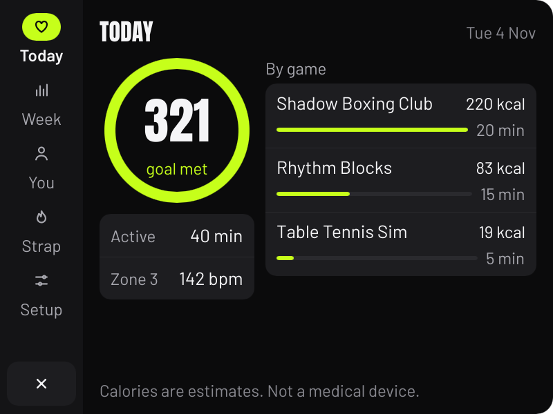
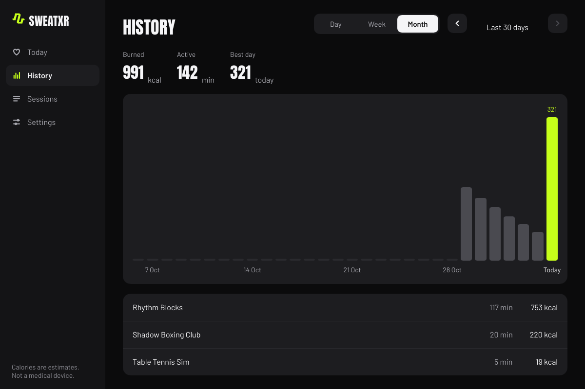

# FitnessVR

A watch on your wrist in every SteamVR game: calories, active minutes, heart rate and a daily
goal ring. History per day and per game. Free, open source (GPL-3.0), and your data never
leaves your computer.

<p>
  
</p>

| VR panel | Desktop history |
|---|---|
|  |  |

Works with any SteamVR game, with no mods or per-game support. Runs on Windows x64, Linux
x64 and Linux arm64 (Steam Frame on-device). Quest works through Steam Link or Virtual Desktop
on a PC; Quest standalone is not supported.

> **Status: first release, looking for testers.** Calorie numbers are estimates and this is not
> a medical device. Comparisons against your fitness watch are the most useful feedback; see
> [Contributing](CONTRIBUTING.md).

## Install in 3 steps

1. Download the archive for your system from the latest release and check it against its
   `.sha256` file.
2. Unpack it anywhere. On Linux or Steam Frame (Developer Mode) run `./install.sh`; on Windows
   keep the folder where it is.
3. Start SteamVR, then run `fitvr` once. It registers itself and starts with SteamVR from then
   on. Turn that off in Settings > Device > Start with SteamVR.

## Use

- **Watch:** on your left wrist (switch hands in Settings). It dims when you are not looking and
  goes full brightness after a short glance; it hides when the controller is near your face. A
  lime dot means a session is being counted.
- **Panel:** point at the watch with the other controller and pull the trigger. Today, Week and
  Settings. Rebind the button in SteamVR's controller bindings under FitnessVR.
- **Desktop:** `fitvr` without SteamVR opens history, export and settings. On Windows it sits in
  the tray.
- **Heart rate:** any Bluetooth LE strap that uses the standard heart rate service. Settings >
  Device > Scan, then pick it. Choosing it on the desktop saves the choice; the VR overlay
  connects.
- **Export:** TCX for today's sessions (opens in most fitness apps) and CSV of every second, to
  `Documents/FitnessVR`.

## Privacy

No account, no telemetry, no network access. Everything is in one SQLite file:
`%APPDATA%\FitnessVR\data\fitvr.db` on Windows, `~/.local/share/fitnessvr/fitvr.db` on Linux.
Logs (`overlay.log`, `desktop.log`) sit next to it and contain game names, nothing else personal.

## Accuracy

All numbers are estimates.

- **With a heart rate strap:** the Keytel et al. (2005) equation from heart rate, weight, age
  and sex. Aim: within about 20% of a dedicated fitness watch.
- **Without one:** head and hand speed mapped to METs. Aim: within about 35%. After 20 minutes
  of play with a strap, the app fits motion to your own heart-rate data and uses that fit when
  the strap is off.
- **What counts:** only time in play. Standing in menus does not count, and the idle minutes
  before a session ends are dropped.

## Build from source

```bash
cargo build --release -p fitvr
```

Linux needs `libdbus-1-dev pkg-config libxkbcommon-dev libfontconfig1-dev`. No OpenVR SDK is
needed: the runtime is loaded from your SteamVR install at start. See
[CONTRIBUTING.md](CONTRIBUTING.md) for tests, snapshots and the headset-free smoke test.

## Contributing

Issues and pull requests are welcome; read [CONTRIBUTING.md](CONTRIBUTING.md) and the
[Code of Conduct](CODE_OF_CONDUCT.md). Report security problems privately as described in
[SECURITY.md](SECURITY.md). Changes are listed in [CHANGELOG.md](CHANGELOG.md).

## Contact

Maintainer contact: open an issue, or for private matters use GitHub's private vulnerability
reporting (see [SECURITY.md](SECURITY.md)).

## License

GPL-3.0-only. See [LICENSE](LICENSE) and [THIRD_PARTY_NOTICES.md](THIRD_PARTY_NOTICES.md).
